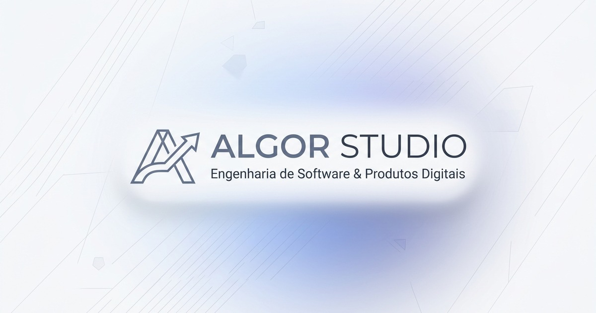

# ALGOR STUDIO — Landing Page Oficial

<div align="center">
  
  <br><br>
  <strong>Estúdio Independente de Engenharia de Software &amp; Produtos Digitais</strong>
  <br>
  <em>Soluções elegantes, escaláveis e de alta performance.</em>
</div>

---

## 🚀 Sobre a ALGOR STUDIO

A **ALGOR STUDIO** é uma empresa independente de tecnologia focada em conceber, arquitetar e construir produtos digitais de alto nível técnico e refinamento visual. Desenvolvemos softwares gerais — sem restrição a nichos específicos —, desde plataformas educativas gamificadas até gestão patrimonial avançada com Inteligência Artificial.

---

## 📦 Produtos em Destaque

| Projeto | Categoria | Status | Tecnologias | Acesso |
| :--- | :--- | :--- | :--- | :--- |
| **[PyExplorer](https://pyexplorer.com.br)** | EduTech / Gamificação / WASM | `Em Produção` | React 19, Pyodide (WASM), Monaco Editor, PWA, Firebase | [pyexplorer.com.br](https://pyexplorer.com.br) |
| **[LogicKids](https://logickids.com.br)** | EduTech / Escolas (B2B) / Lógica | `Em Desenvolvimento` | Next.js 16, FastAPI, PostgreSQL, Blockly, Docker | [logickids.com.br](https://logickids.com.br) |
| **Family Finance** | FinTech / IA / Gestão Patrimonial | `Em Desenvolvimento` | React 19, Gemini AI, Firebase, Recharts, Vite | Em breve |

---

## 🛠 Arquitetura & Stack da Landing Page

Construída sob a filosofia de **máxima velocidade, zero overhead de runtime e 100/100 no Google Lighthouse**:

- **Estrutura:** HTML5 Semântico Puro (`<header>`, `<nav>`, `<main>`, `<section>`, `<article>`, `<dialog>`, `<footer>`).
- **Estilos:** Vanilla CSS Moderno com Design Tokens, CSS Grid, Flexbox, tipografia fluida com `clamp()` e sombras multicamadas inspiradas em referências de alto padrão (Stripe / Linear).
- **Interações:** Vanilla JavaScript ES6+ Modular com elemento nativo `<dialog>` para modais acessíveis e filtros dinâmicos de projetos.
- **SEO & Acessibilidade:**
  - Dados Estruturados Schema.org JSON-LD (`Organization`, `WebSite`, `ItemList` e `SoftwareApplication`).
  - Open Graph e Twitter Cards completos.
  - Conformidade WCAG 2.1 AA com navegação por teclado e suporte nativo à tecla `Escape`.
  - Zero dependências de terceiros no bundle principal.

---

## 💻 Como Rodar Localmente

Clone o repositório e execute um servidor HTTP simples:

```bash
# Servidor HTTP nativo do Python 3
python3 -m http.server 8080

# Ou via npx
npx -y serve . -p 8080
```

Abra no navegador: `http://localhost:8080`

---

## 📄 Licença

Propriedade de **ALGOR STUDIO** © 2026. Todos os direitos reservados.
